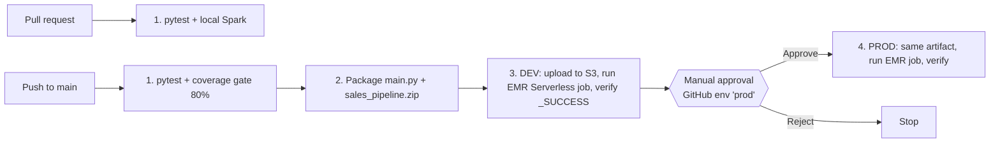

# EMR Serverless + Spark CI/CD demo (GitHub Actions, pytest, manual approval)

## Flow



| Stage | Where it runs | AWS cost |
|---|---|---|
| 1. Test (pytest, local[1] Spark) | GitHub runner | $0 |
| 2. Package | GitHub runner | $0 |
| 3. Deploy dev | S3 + EMR Serverless | per-second usage, ~1 driver + 1 executor |
| Approval | GitHub `prod` environment | $0 (nothing runs while waiting) |
| 4. Deploy prod | S3 + EMR Serverless | same as dev |

## Layout

```
.github/workflows/ci-cd.yml   pipeline
infra/template.yaml           S3, EMR Serverless app, job role, GitHub OIDC role
scripts/run_emr_job.sh        submit -> poll -> verify -> job summary (cancels job if GH job is cancelled)
src/main.py                   Spark entry point
src/sales_pipeline/           transforms (unit-tested)
tests/                        pytest
data/sales.csv                sample input (includes dirty rows)
```

## Setup (one time)

1. Push this folder to a new GitHub repo (`main` branch).
2. Deploy infra (see CLI section). Use `CreateOidcProvider=false` if your account already has the GitHub OIDC provider.
3. Set repo variables from the stack outputs: `AWS_REGION`, `AWS_ROLE_ARN`, `S3_BUCKET`, `EMR_APP_ID`, `EMR_JOB_ROLE_ARN`.
4. Create environments `dev` (no rules) and `prod` with **Required reviewers** = you. Required reviewers is free on public repos; private repos need GitHub Pro/Team/Enterprise.
5. Push a commit or run the workflow manually.

## Where to check each step

| Step | GitHub | AWS console |
|---|---|---|
| 1. Tests | Actions -> run -> job "1. Unit tests" -> Summary shows pytest table; artifact `test-reports` (junit + coverage) | - |
| 2. Package | Same run -> artifact `emr-bundle` | - |
| 3. Dev upload | Job log "Upload artifacts" | S3 -> bucket -> `artifacts/<sha>/`, `data/` |
| 3. Dev job | Job summary: job run ID, state, billed vCPU/GB-hours | EMR -> EMR Serverless -> Manage applications (opens EMR Studio) -> `emr-cicd-demo-spark` -> Job runs -> `sales-dev-<sha>` -> Spark UI / logs |
| 3. Dev output | Job log prints result table | S3 -> `dev/output/<sha7>/` (`_SUCCESS` + parquet); logs under `logs/applications/<appId>/jobs/<jobId>/SPARK_DRIVER/` |
| Approval | Run page shows "Review deployments" -> select `prod` -> Approve / Reject. Approver also gets email/notification | - |
| 4. Prod | Job "4. Deploy & run on EMR (prod)" summary | Same app, job `sales-prod-<sha>`, output `prod/output/<sha7>/` |
| Auth audit | Settings -> Environments -> `prod` -> deployment history | CloudTrail -> Event history -> `AssumeRoleWithWebIdentity`, `StartJobRun` |
| Cost | - | Billing -> Cost Explorer, filter Service = EMR; tag `env` / `commit` on each job run |

## Cost controls built in

| Control | Where |
|---|---|
| Serverless, no cluster/EC2 idling; no pre-initialised capacity | `SparkApp` in template |
| Auto-stop after 1 min idle | `AutoStopConfiguration` |
| ARM64 (Graviton) - cheaper per vCPU/GB-hour | `Architecture` |
| App-wide ceiling 4 vCPU / 16 GB | `MaximumCapacity` |
| 1 driver + 1 executor, 1 vCPU / 2 GB / 20 GB disk, no dynamic allocation | `SPARK_PARAMS` in script |
| Job hard timeout 30 min + cancel on GH cancel | `--execution-timeout-minutes`, `trap` |
| PRs run tests only (no AWS) | `if: github.event_name != 'pull_request'` |
| S3 objects expire after 7 days | bucket lifecycle |
| No NAT/VPC, no CloudWatch log group (logs go to S3) | design |

A demo run is typically well under $0.10 total; the job summary shows the actual billed usage. Check current rates on the [EMR pricing page](https://aws.amazon.com/emr/pricing/) or the [AWS Pricing Calculator](https://calculator.aws/).

## Teardown

Empty the bucket, then delete the stack (commands below). Nothing else is billed while idle.

## CLI reference (PowerShell)

```powershell
# --- local tests (needs Java 17 + Python 3.9-3.11 for PySpark 3.5) ---
uv venv --python 3.11 .venv
uv pip install --python .venv\Scripts\python.exe -r requirements-dev.txt
$env:PYSPARK_PYTHON = (Resolve-Path .venv\Scripts\python.exe).Path
.venv\Scripts\python -m pytest --cov=sales_pipeline --cov=main

# --- deploy infra ---
$REGION="us-east-1"; $ORG="<github-owner>"; $REPO="<repo-name>"
# Newer repos use immutable OIDC subjects (repo:owner@id/repo@id) - read the real prefix after creating the repo:
$SUB = gh api "repos/$ORG/$REPO/actions/oidc/customization/sub" --jq .sub_claim_prefix
aws cloudformation deploy --region $REGION --stack-name emr-cicd-demo `
  --template-file infra/template.yaml --capabilities CAPABILITY_NAMED_IAM `
  --parameter-overrides GitHubOrg=$ORG GitHubRepo=$REPO CreateOidcProvider=true "GitHubSubjectPrefix=$SUB"
aws cloudformation describe-stacks --region $REGION --stack-name emr-cicd-demo `
  --query "Stacks[0].Outputs" --output table

# --- GitHub repo variables (values from outputs above) ---
gh variable set AWS_REGION       --body $REGION
gh variable set AWS_ROLE_ARN     --body "<GitHubRoleArn>"
gh variable set S3_BUCKET        --body "<S3Bucket>"
gh variable set EMR_APP_ID       --body "<EmrAppId>"
gh variable set EMR_JOB_ROLE_ARN --body "<EmrJobRoleArn>"

# --- environments: dev (open), prod (manual approval by you) ---
$ME = gh api user --jq .id
gh api -X PUT "repos/$ORG/$REPO/environments/dev"
'{"reviewers":[{"type":"User","id":' + $ME + '}]}' | gh api -X PUT "repos/$ORG/$REPO/environments/prod" --input -

# --- run / watch / approve ---
gh workflow run ci-cd.yml
gh run watch
gh run view --web          # click "Review deployments" -> prod -> Approve

# --- inspect EMR jobs ---
aws emr-serverless list-job-runs --region $REGION --application-id <EmrAppId> --max-results 5
aws emr-serverless get-job-run --region $REGION --application-id <EmrAppId> --job-run-id <JobRunId>
aws emr-serverless get-dashboard-for-job-run --region $REGION --application-id <EmrAppId> --job-run-id <JobRunId>
aws s3 ls s3://<S3Bucket>/ --recursive

# --- teardown ---
aws s3 rm s3://<S3Bucket> --recursive
aws cloudformation delete-stack --region $REGION --stack-name emr-cicd-demo
aws cloudformation wait stack-delete-complete --region $REGION --stack-name emr-cicd-demo
```
